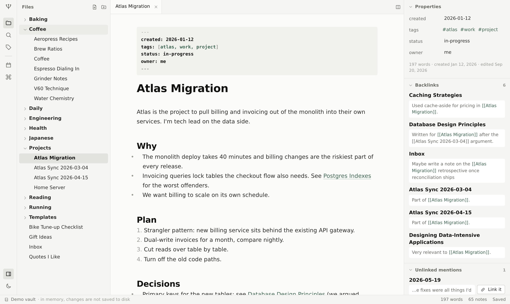

# Mycel

A local-first markdown notes app that works on a folder you already have.

Point Mycel at any folder of `.md` files and it reads your `[[wikilinks]]`, `#tags` and YAML
frontmatter as they are. There is no import step, no database file next to your notes, and no
account. Mycel only writes to a file when you change that file.



## Status

Mycel is early (v0.1). The core notes app is done and tested. The graph view and the on-device
AI features (semantic link suggestions, a time-travel view of how a vault grew, a vault linter
with contradiction detection) are planned; see [PLAN.md](PLAN.md).

## Features

**Your folder, as it is**
- Open a folder with the browser's File System Access API. Mycel remembers it and asks for
  permission again after a reload.
- Changes made by other programs show up within a few seconds. If you were editing the same
  note, Mycel asks whether to keep your version or load the one on disk.
- Writes are atomic (`createWritable` swaps the file in on close), unchanged files are never
  rewritten, and frontmatter and unknown syntax are kept byte for byte.
- Deleting moves a note to `.trash/` inside the vault. Nothing is permanently deleted.

**Writing**
- CodeMirror 6 editor with live preview: headings, emphasis, links, task checkboxes, lists,
  quotes and code render inline; the raw markdown shows on the line you are editing.
- Autosave, undo history per tab, tabs, and two side-by-side panes.
- `[[Note]]`, `[[Note|alias]]` and `[[Note#Heading]]` links with autocomplete for notes,
  aliases, headings and tags. Click a link to follow it; click a link to a missing note to
  create it.
- Daily notes and templates (`{{date}}`, `{{time}}`, `{{title}}`) from a `Templates/` folder.

**Finding and connecting**
- Backlinks with the surrounding sentence.
- Unlinked mentions: notes that name this note without linking it, with a one-click "Link it".
- Rename or move a note and every link to it is updated across the vault.
- Quick switcher, command palette, and full-text search with highlighted matches and a
  `tag:` filter.
- Tag browser (inline and frontmatter tags, nested `#a/b` tags) and an editable properties panel.

**Comfort**
- Light and dark themes, keyboard navigation everywhere, a file tree with drag and drop.

## Try it

You need Node.js 20 or newer.

```bash
npm install
npm run dev
```

Open http://localhost:5173 and either choose **Open folder…** or **Try the demo vault**.
Opening a real folder needs a desktop Chromium browser (Chrome, Edge, Brave, Arc). The demo
vault works in any modern browser; its changes stay in memory.

The demo vault in [`demo-vault/`](demo-vault) is 65 notes written over ten months by a
fictional software engineer who also bakes, runs and is learning Japanese. It deliberately
contains orphans, near-duplicates, broken links, claims that were later corrected and notes
that contradict each other, so it doubles as the test fixture for the features to come.

## Keyboard shortcuts

| Action | Shortcut |
|---|---|
| Quick switcher | Ctrl/⌘ O |
| Command palette | Ctrl/⌘ P |
| Search all notes | Ctrl/⌘ Shift F |
| New note | Alt N |
| Today's daily note | Alt D |
| Insert template | Alt T |
| Rename note | F2 |
| Split / switch pane | Ctrl/⌘ \ |
| Close tab | Alt W |
| Next / previous tab | Alt . / Alt , |
| Toggle theme | Alt L |
| Bold / italic | Ctrl/⌘ B / Ctrl/⌘ I |

Shortcuts avoid the keys browsers reserve (Ctrl+N, Ctrl+T, Ctrl+W).

## Privacy

Mycel has no backend. Your notes are read and written by your browser on your computer and are
never sent anywhere. There is no telemetry and no account. The only thing Mycel stores outside
your folder is the folder handle and a few UI preferences in the browser's local storage.

## Development

```bash
npm test           # unit tests (Vitest)
npm run e2e        # end-to-end tests (Playwright; run `npx playwright install chromium` once)
npm run typecheck
npm run lint
npm run build
```

The code is organised so the core logic has no browser dependencies:

- `src/core/` parser, link resolution, link rewriting, vault index, search (pure TypeScript)
- `src/fs/` storage behind a `VaultFS` interface: File System Access and in-memory
- `src/vault/` every operation that changes files (`actions.ts`) and vault loading
- `src/editor/` CodeMirror extensions: live preview, links, autocomplete
- `src/components/` React UI

[ARCHITECTURE.md](ARCHITECTURE.md) covers the data model, indexing pipeline and write-safety
rules. End-to-end tests run against the demo vault and against a real folder through the
browser's Origin Private File System, which uses the same API as a folder you pick.

## Contributing

Issues and pull requests are welcome. Please run `npm test`, `npm run typecheck` and
`npm run lint` before opening a pull request, and keep the rule that matters most: never
change a user's file unless they asked for that change.

## License

[MIT](LICENSE)
